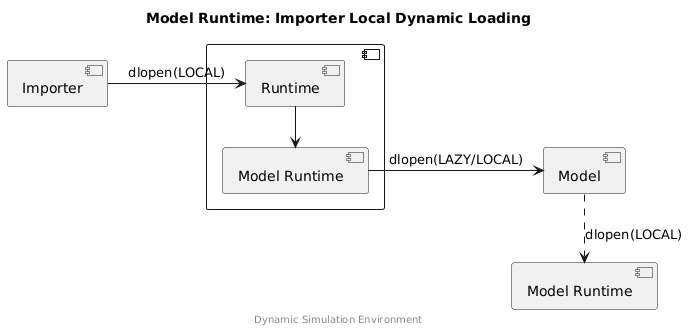

<!--
Copyright 2024 Robert Bosch GmbH

SPDX-License-Identifier: Apache-2.0
-->

# Model Runtime Example

## Introduction

This example implementation of a Model Runtime includes:

* **Importer** - implements a simple importer for the ModelC (`model.h`) interface.
* **Runtime** - implements the importer interface and calls the ModelC Model Runtime
  (`runtime.h`).
* **Simulation** - provides CSV input, a ModelC linear model, and a ModelC PDU
  observer.

### Project Structure

```text
dse/modelc/examples/runtime
├── sim
│   ├── data
│   │   └── simulation.yaml          Simulation definition.
│   ├── model
│   │   ├── input/data
│   │   │   ├── input.csv            CSV input data.
│   │   │   ├── model.yaml           Input model definition.
│   │   │   └── signalgroup.yaml     Input signal group definition.
│   │   ├── linear/data
│   │   │   ├── model.yaml           Linear model definition.
│   │   │   └── signalgroup.yaml     Linear signal group definition.
│   │   └── observer/data
│   │       ├── model.yaml           Observer model definition.
│   │       └── signalgroup.yaml     Observer signal group definition.
│   ├── csv_input.c                  Reads CSV inputs.
│   ├── linear_model.c               Calculates output = input * factor + offset.
│   └── observer_model.c             Publishes output as an NCodec PDU.
├── CMakeLists.txt                   Builds and installs the example.
├── importer.c                       Example importer (implements model.h).
├── runtime.c                        Example importer/runtime model.
└── README.md                        This document.
```

The model definitions and input data are included in this example. The packaged
simulation uses `sim/data/simulation.yaml` and the model-specific `sim/model`
directories.


## Usage

### Run the Example

```bash
# Clone and build the project:
$ git clone https://github.com/boschglobal/dse.modelc.git
$ cd dse.modelc
$ make

# Run the example:
$ cd dse/modelc/build/_out
$ examples/runtime/bin/importer \
  examples/runtime/lib/libruntime.so \
  examples/runtime/sim \
  data/simulation.yaml \
  input,linear,observer
Importer: Cwd: /mnt/c/Users/rut6abt/Desktop/git/working/dse.modelc
Importer: Runtime: dse/modelc/build/_out/examples/runtime/lib/libruntime.so
Importer: Simulation Path: dse/modelc/build/_out/examples/runtime/sim
Importer: Simulation YAML: data/simulation.yaml
Importer: Model: input,linear,observer
Importer: Runtime Model runtime @ 0.000500
Importer:   Name: scalar
Importer:       - name : output
Importer:         value: 5
Importer: PDU id=1001 ecu_id=2 swc_id=5 [0.000500]output=5.000000
```

Each importer step prints the linear model's signal values and any PDU messages
received by the virtual model.


## Linking Strategy

### Importer using Dynamic Loading

In this scenario the Runtime is loaded (by the importer) using `dlopen()` with
flags `RTLD_NOW` and `RTLD_LOCAL`. Runtime is dynamically linked to the
ModelC shared library (`libmodelc.so`) and this library is loaded at this point.
Models which are _also_ dynamically linked to the ModelC shared library, when
loaded by the Runtime, will also use the previously loaded `libmodelc.so`.





## Developer

```bash
# Use GDB:
$ gdb -q -ex='set confirm on' -ex=run -ex=quit --args \
    dse/modelc/build/_out/examples/runtime/bin/importer \
    dse/modelc/build/_out/examples/runtime/lib/libruntime.so \
    dse/modelc/build/_out/examples/runtime/sim \
    data/simulation.yaml \
    input,linear,observer

# Use Valgrind:
$ valgrind -q --leak-check=yes \
    dse/modelc/build/_out/examples/runtime/bin/importer \
    dse/modelc/build/_out/examples/runtime/lib/libruntime.so \
    dse/modelc/build/_out/examples/runtime/sim \
    data/simulation.yaml \
    input,linear,observer

# Inspect Runtime linking.
$ readelf -d dse/modelc/build/_out/examples/runtime/lib/libruntime.so

Dynamic section at offset 0x2df0 contains 27 entries:
  Tag        Type                         Name/Value
 0x0000000000000001 (NEEDED)             Shared library: [libmodelc.so]
 0x0000000000000001 (NEEDED)             Shared library: [libc.so.6]
 0x000000000000000e (SONAME)             Library soname: [libruntime.so]
 0x000000000000001d (RUNPATH)            Library runpath: [$ORIGIN]
 ....
```
